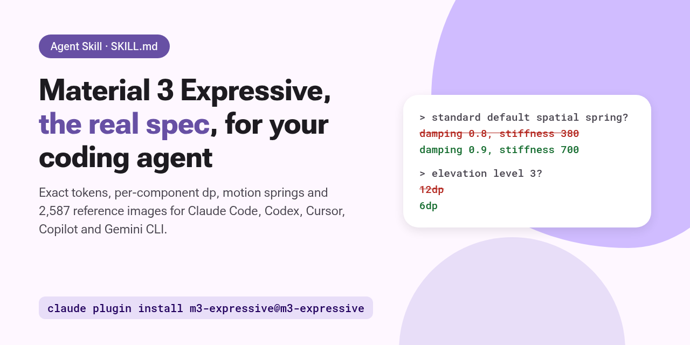

# M3 Expressive: a Material Design 3 skill for AI coding agents

**Give Claude Code, Codex, Cursor, Copilot, and Gemini CLI the real Material Design 3 spec.** Exact
design tokens, per-component dp geometry, motion spring values, shape morphing rules, emphasized
typography, color roles, and 2,587 reference images, packaged as an
[Agent Skill](#what-an-agent-skill-is) your assistant loads on its own the moment you ask for
Material UI.




```bash
claude plugin marketplace add abhixv/m3-expressive-design-skill
claude plugin install m3-expressive@m3-expressive
```

Not on Claude? Jump to [Codex](#codex-cli), [Cursor](#cursor), [GitHub Copilot](#github-copilot),
[Gemini CLI](#gemini-cli), or
[Windsurf, Cline, opencode, Zed, and anything else](#any-other-agent-the-universal-method).

---

## Why this exists

Ask any model for a Material 3 Expressive spec and it will answer instantly, in the right vocabulary,
with numbers that look exactly like real tokens. Some of them are. The rest are invented, and an
invented dp value is indistinguishable from a real one on the page, so it ships.

This skill closes that gap two ways. It puts the actual values in reach, and it holds the model to a
**source contract**: every number, token name, and component name must be looked up, and anything M3
doesn't publish gets labelled as a design decision instead of quietly passed off as spec.

| You ask | Unassisted | With this skill |
|---|---|---|
| "Standard scheme default spatial spring?" | damping 0.8, stiffness 380 (those are the *expressive* values) | **damping 0.9, stiffness 700** |
| "What does elevation level 3 resolve to?" | 12dp | **6dp** |
| "Radius for a child inside a 48dp card with 16dp padding?" | "48dp, keep it consistent" | **32dp**, since `inner = outer − padding` |
| "Gap between the two action buttons?" | a number, stated as spec | *"My design decision (not in M3): 12dp"* |
| "Fade the color with a bouncy spring?" | sure | color and opacity take **effects** springs: damping 1.0, no overshoot |
| "Ship this expressive treatment on web" | sure | availability is uneven, so it checks `platforms.md` first |

The last two matter as much as the first three. Most Material mistakes aren't missing knowledge,
they're **plausible defaults applied to the wrong component**, and those are what the do/don't rules
in each reference catch.

**Measured.** 14 questions whose answers are exact values from the references, asked through
`claude -p` with no tools and no skill, then again with this plugin loaded. Run on 11 October 2026:

| Model | Without the skill | With the skill |
|---|---|---|
| Claude Sonnet | 11/14, and 2 of the 3 misses were confidently wrong numbers | **14/14** |
| Claude Haiku | 10/14, all 4 misses answered "unknown" | **14/14** |

The first two rows of the table above are the two wrong answers Sonnet gave. Strong models already
know a lot of M3 from memory; the skill's job is the remaining values, and the ones they get wrong
without noticing.

## What you get

| Path | Contents |
|---|---|
| `SKILL.md` | Entry point: source contract, quick-reference decision table, the 7 expressive tactics, router, common-mistakes table |
| `references/tokens.md` | The numeric bedrock: 30 type styles, the 10-step corner scale, spring damping/stiffness for both schemes, web curve conversions, elevation, contrast levels |
| `references/component-tokens.md` | **916 per-component values** across 104 component groups: container heights and widths, icon sizes, internal spacing, shape and elevation assignments |
| `references/components/*.md` | 7 files, 40+ components. The sibling-choice rule ("use this instead of that when..."), anatomy, every size variant, placement, states, color and type role mapping, do/don'ts |
| `references/motion.md`, `shape.md`, `typography.md`, `color.md`, `color-schemes.md`, `transitions.md` | The style systems in depth: motion schemes, 35 shapes and morphing, baseline vs emphasized type, role pairing, dynamic color, transition patterns |
| `references/layout.md`, `interaction.md`, `foundations.md`, `platforms.md` | Breakpoints and canonical layouts. States, gestures, accessibility. Elevation, spacing, icons. Per-platform API availability |
| `references/expressive-tactics.md` | The 7 tactics in depth, the research behind them, what actually shipped |
| `visuals/` + `references/visuals.md` | **2,587 images**: anatomy diagrams, measurement specs, state grids, do/don't pairs, full-screen canonical layouts, with a greppable caption index |
| `scripts/` | Two refresh scripts, for when Material ships an update |

**Size:** text + scripts = **800 KB**. Images = **495 MB** and entirely optional, since every number
lives in the markdown. See [slim install](#slim-install-text-only).

## Install

### Claude Code

**As a plugin.** One command, and `claude plugin marketplace update` keeps it current:

```bash
claude plugin marketplace add abhixv/m3-expressive-design-skill
claude plugin install m3-expressive@m3-expressive
```

```bash
claude plugin list                                  # what's installed
claude plugin marketplace update m3-expressive      # pull updates
claude plugin uninstall m3-expressive
```

**As a personal skill.** Available in every project. Claude Code picks up any directory under
`~/.claude/skills/` that contains a `SKILL.md`:

```bash
git clone https://github.com/abhixv/m3-expressive-design-skill.git ~/m3-skill
ln -s ~/m3-skill/skills/m3-expressive ~/.claude/skills/m3-expressive
```

<details>
<summary>Windows PowerShell</summary>

```powershell
git clone https://github.com/abhixv/m3-expressive-design-skill.git "$env:USERPROFILE\m3-skill"
New-Item -ItemType Directory -Force "$env:USERPROFILE\.claude\skills" | Out-Null
Copy-Item -Recurse -Force `
  "$env:USERPROFILE\m3-skill\skills\m3-expressive" "$env:USERPROFILE\.claude\skills\"
```
</details>

**As a project skill.** Commit it, and everyone who clones your repo gets it, scoped to that project:

```bash
mkdir -p .claude/skills
cp -r /path/to/m3-skill/skills/m3-expressive .claude/skills/
git add .claude/skills/m3-expressive && git commit -m "Add m3-expressive skill"
```

```
your-project/
└── .claude/
    └── skills/
        └── m3-expressive/
            ├── SKILL.md
            ├── references/
            ├── scripts/
            └── visuals/        # consider .gitignore-ing, see slim install
```

### Claude apps (web, desktop, mobile)

Zip the **text-only** build and upload it under **Settings > Capabilities > Skills**. The images are
far past any upload limit, so leave them out. The skill is fully functional without them:

```bash
cd /path/to/m3-skill/skills
zip -r m3-expressive.zip m3-expressive -x "m3-expressive/visuals/*"
```

### Codex CLI

Codex reads `AGENTS.md`, either the repo's at the project root or a global one at
`~/.codex/AGENTS.md`. Clone the skill once, then point Codex at it:

```bash
git clone https://github.com/abhixv/m3-expressive-design-skill.git ~/m3-skill
```

Append the [pointer block](#the-pointer-block) to `~/.codex/AGENTS.md` (global) or your project's
`AGENTS.md` (per-repo). If your Codex version supports skill directories natively, drop it in there
instead. Same folder, no changes:

```bash
mkdir -p ~/.codex/skills
ln -s ~/m3-skill/skills/m3-expressive ~/.codex/skills/m3-expressive
```

### Cursor

Cursor loads project rules from `.cursor/rules/*.mdc`. Vendor the skill into the repo, then add a rule
that routes to it:

```bash
mkdir -p .cursor/rules .agent-skills
cp -r /path/to/m3-skill/skills/m3-expressive .agent-skills/
```

`.cursor/rules/m3-expressive.mdc`:

```markdown
---
description: Material Design 3 / M3 Expressive spec, tokens, component dp, motion springs
globs: ["**/*.kt", "**/*.dart", "**/*.tsx", "**/*.css"]
alwaysApply: false
---

Read `.agent-skills/m3-expressive/SKILL.md` before writing any Material Design UI, then follow
its "Where to look" table into the specific reference file. Never state a dp value, token name,
or spring parameter from memory. Look it up. Label anything not in M3 as a design decision.
```

### GitHub Copilot

Copilot reads `.github/copilot-instructions.md`. Vendor the skill into the repo and add the
[pointer block](#the-pointer-block) to that file:

```bash
mkdir -p .agent-skills .github
cp -r /path/to/m3-skill/skills/m3-expressive .agent-skills/
```

### Gemini CLI

Gemini CLI reads `GEMINI.md`, at the project root or `~/.gemini/GEMINI.md` globally. Same move: clone
the skill, add the [pointer block](#the-pointer-block).

### Any other agent, the universal method

Windsurf (`.windsurf/rules/`), Cline (`.clinerules/`), opencode and Zed (`AGENTS.md`), Aider
(`CONVENTIONS.md`), or anything with a system-prompt file: the mechanism is always the same two steps.

1. **Put the folder somewhere the agent can read.** Either `.agent-skills/m3-expressive/` in the repo,
   or `~/m3-skill/skills/m3-expressive` globally.
2. **Add the pointer block** to whatever instruction file that agent loads.

Some runtimes are converging on a shared `~/.agents/skills/` location. If yours does, one symlink
covers all of them at once:

```bash
mkdir -p ~/.agents/skills
ln -s ~/m3-skill/skills/m3-expressive ~/.agents/skills/m3-expressive
```

#### The pointer block

Paste this into `AGENTS.md`, `GEMINI.md`, `.github/copilot-instructions.md`, `CLAUDE.md`, or your
agent's equivalent. Fix the path to match where you put the folder:

```markdown
## Material Design 3 / M3 Expressive

The M3 spec lives at `.agent-skills/m3-expressive/`.

Before writing or reviewing any Material Design UI (components, dp values, corner radii,
motion springs, type styles, color roles, adaptive layouts), read
`.agent-skills/m3-expressive/SKILL.md` and follow its "Where to look" table into the
specific reference file.

Never state a number, token name, or component name from memory. Look it up:
- exact values (type scale, radii, springs, elevation) -> `references/tokens.md`
- per-component dp geometry -> `references/component-tokens.md`
- component behavior, variants, do/don'ts -> `references/components/*.md`
- platform API availability -> `references/platforms.md`

If a value genuinely isn't in M3, say so and label it "my design decision (not in M3)"
rather than presenting it as spec.
```

That block is the whole trick. It transplants the source contract into agents that don't
auto-discover skills, which is why this works the same everywhere.

### Slim install (text-only)

The 495 MB of images is the only heavy part. Install without them, and pull them down later if you
ever want them:

```bash
rsync -a --exclude visuals/ /path/to/m3-skill/skills/m3-expressive/ ~/.claude/skills/m3-expressive/

# regenerate whenever you want them (~5 min, 2,587 files)
cd ~/.claude/skills/m3-expressive && node scripts/refresh-m3.js images visuals
```

Cloning this repo gets you the images already, so it works offline with no extra step. If you're
vendoring the skill into your own repo and want it light, exclude them. They rebuild from
`INDEX.tsv` plus the refresh script:

```gitignore
skills/m3-expressive/visuals/*
!skills/m3-expressive/visuals/INDEX.tsv
```

## Verify it loaded

Restart your agent, since skills are discovered at startup, then ask something only the skill can
answer:

> What are the expressive fast spatial spring values, and what corner radius should a child inside a
> 48dp-radius card with 16dp padding use?

Correct: **damping 0.6 / stiffness 800**, and **32dp** (`inner = outer − padding`). Anything else and
the skill isn't being read. Check that the folder contains `SKILL.md` at its top level, and that your
pointer path is right.

## Using it

Claude Code loads it automatically whenever a request touches Material Design. The skill's
`description` triggers on M3, M3 Expressive, Material You, Material components, motion springs, shape
morphing, emphasized typography, color roles, adaptive layout, and Jetpack Compose / MDC-Android /
Flutter / web Material UI. You can also invoke it by name:

```
/m3-expressive
```

It's built for three kinds of work:

- **Designing.** *"Design a now-playing screen with M3 Expressive."* You get a spec with real token
  values, and every unpublished value labelled as a decision rather than smuggled in as spec.
- **Implementing.** *"Build this as a Compose component."* `references/platforms.md` gets checked
  first: availability is uneven, and M3 Expressive APIs are experimental until Compose 1.5.0.
- **Reviewing.** *"Check this screen against M3."* The common-mistakes table and the per-component
  do/don't rules exist for exactly this pass.

## Keeping it current

```bash
cd ~/.claude/skills/m3-expressive

node scripts/refresh-m3.js pages /tmp/m3-pages    # guideline prose to markdown
node scripts/refresh-m3.js images visuals         # reference images + caption index
node scripts/refresh-component-tokens.js          # per-component dp, rewrites the reference in place
```

`refresh-component-tokens.js` is byte-reproducible and writes over its reference directly. The other
two write to a directory you name, so diff before folding changes in, since the references carry
hand-written organization on top of the raw output. Requires Node.js; nothing else here does.

**On accuracy.** Design guidance, placement rules, and do/don'ts come from the Material guidelines.
The `md.comp.*` geometry in `component-tokens.md`, plus the type scale, spring, shape, and elevation
values, comes from the generated `androidx.compose.material3.tokens` sources, and each group carries
the generator version it was taken from. The two are kept distinct on purpose, so the skill can
attribute correctly. Known gaps are recorded as `## Gaps` sections rather than filled with plausible
values. Captured **July 2026**.

## FAQ

### What an agent skill is

A folder with a `SKILL.md` at its root, carrying YAML frontmatter with a `name` and a `description`.
The agent reads only the description until something in your request matches it, then loads the body
and, from there, whichever reference files it needs. It's why 800 KB of specification costs almost no
context until the moment it's relevant.

### Does it work with models other than Claude?

Yes. `SKILL.md` and the references are plain markdown with no Claude-specific syntax. Claude Code
discovers the folder automatically; every other agent needs the [pointer block](#the-pointer-block),
which takes about thirty seconds.

### Do I need the 495 MB of images?

No. Every number, rule, and token lives in the markdown. The images are for reading measurement
diagrams and canonical screens, useful when a spec is ambiguous and optional otherwise. See
[slim install](#slim-install-text-only).

### Is M3 Expressive a new version of Material?

No. It's an evolution of Material 3, not "M4", and M3 isn't deprecated. It adds components, updated
tokens, and design tactics. `SKILL.md` opens with this because getting it wrong colors every
downstream decision.

### Does it cover Compose, Flutter, and web equally?

It covers the *design system* for all of them, and is explicit that *platform availability* is uneven.
`references/platforms.md` maps what's actually shipped where. Compose M3 Expressive APIs are
experimental until Compose 1.5.0; MDC-Android and Material Web are in maintenance mode.

### Will it override my own design system?

No. It supplies M3 values when you ask for M3. When you're working against your own tokens, it's the
component behavior, sibling-choice rules, and do/don'ts that carry over.

## Contributing

Corrections to values, gaps worth filling, and install recipes for agents not covered here are all
welcome. Open an issue or a PR. If you're correcting a number, cite where the real one lives so it can
be verified.

## License

**MIT** for this repository's original work: the refresh scripts, the skill structure, and the
authored organization of the references. See [LICENSE](LICENSE).

Everything else keeps its own license, and [NOTICE.md](NOTICE.md) records which is which:

- **Material Design guidelines** (the design guidance in `references/`) are © Google LLC, used under
  [CC BY 4.0](https://creativecommons.org/licenses/by/4.0/) with attribution
- **AndroidX token values** (`component-tokens.md`) are Apache License 2.0, © The Android Open Source
  Project; values extracted and reformatted, none altered
- **Reference images** (`visuals/`) are © Google LLC, included unmodified for reference, and optional.
  [Exclude them](#slim-install-text-only) if you'd rather not redistribute them.

Material Design, Material You, Android, and Jetpack Compose are trademarks of Google LLC. **This
project is not affiliated with, sponsored by, or endorsed by Google.**
